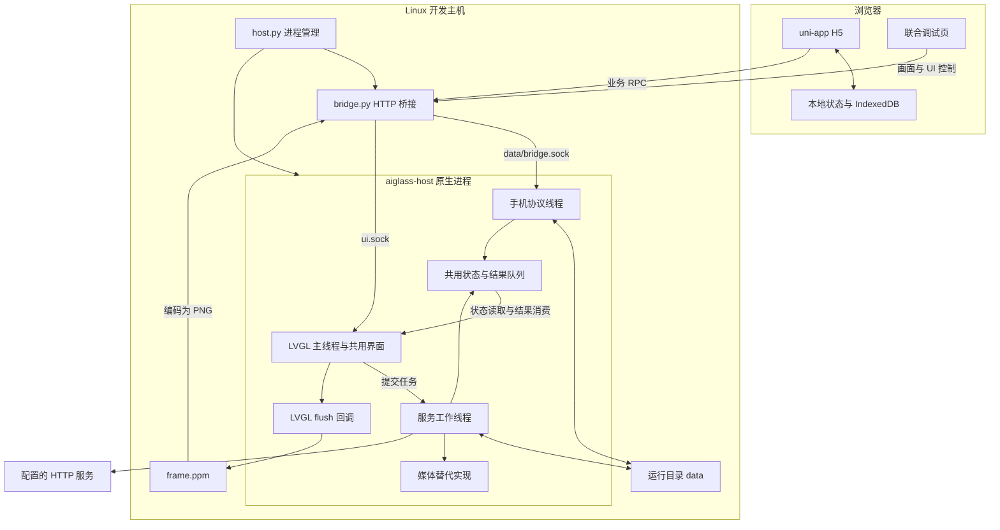
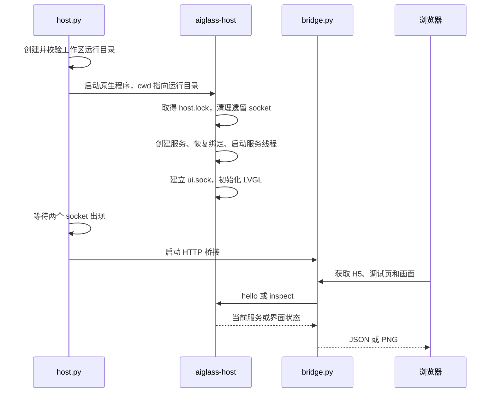
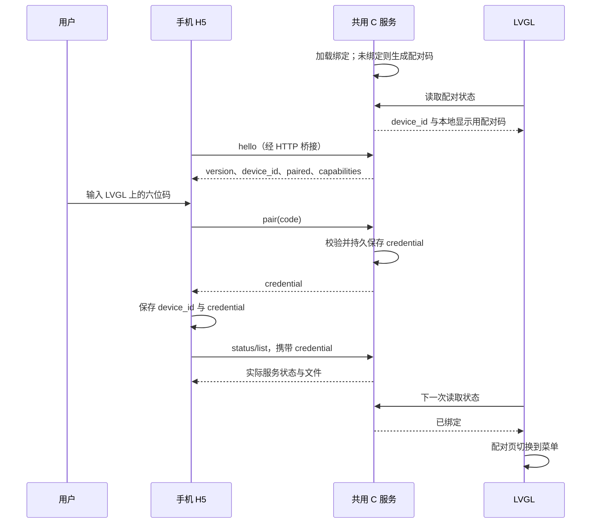

# Linux 主机模拟器架构

本文说明 `Application/host-debug` 的构建组成、运行模型、接口、状态存储和扩展约束。
适用于维护 LVGL 界面、手机伴侣、Linux 服务及自动测试的开发者。
日常构建与预览命令见 [使用说明](README.md)；设备部署角色见
[V821 运行模式](../RUNTIME_MODES.md)；业务报文定义见
[手机通信协议 v2](../lvgl-home/README.md#手机通信协议-v2)。

## 目录

- [1. 定位与系统边界](#1-定位与系统边界)
- [2. 总体结构](#2-总体结构)
- [3. 源码复用与平台适配](#3-源码复用与平台适配)
- [4. 构建与进程生命周期](#4-构建与进程生命周期)
- [5. 线程与任务模型](#5-线程与任务模型)
- [6. 显示与输入](#6-显示与输入)
- [7. 通信接口](#7-通信接口)
- [8. 配对与连接状态](#8-配对与连接状态)
- [9. 文件与传输](#9-文件与传输)
- [10. 消息与外部服务](#10-消息与外部服务)
- [11. 数据布局与隔离](#11-数据布局与隔离)
- [12. 配置与运行参数](#12-配置与运行参数)
- [13. 测试设计](#13-测试设计)
- [14. 扩展与设备集成](#14-扩展与设备集成)
- [15. 故障定位](#15-故障定位)
- [16. 源码索引](#16-源码索引)

## 1. 定位与系统边界

模拟器是在开发主机上原生编译并运行的 LVGL 应用环境。它使用与常电 UI 模式相同的界面、
配对、文件、消息和 HTTP 服务源码，以软件帧缓冲替代物理显示，以浏览器输入替代设备输入。
手机 H5 通过本地 HTTP 桥接访问正在运行的 C 服务。

该环境不执行 V821 指令集仿真，不启动板端 Linux 镜像，也不模拟 E907、JL、MPP 或外设寄存器。
因此，主机测试能够验证共用应用代码的行为，不能证明目标工具链、BSP、驱动或硬件时序兼容。

### 1.1 与应用工程的关系

| 工程 | 职责 | 在主机环境中的关系 |
| --- | --- | --- |
| `lvgl-home` | 常驻显示、业务服务、手机协议 | 核心源码直接编入 `aiglass-host` |
| `host-debug` | 主机入口、软件显示、HTTP 桥接、调试页、测试 | 提供运行和观测环境 |
| `mobile-app` | uni-app 手机伴侣 | 以 H5 运行，通过业务协议访问 C 服务 |
| `mpp-media` | V821 本地媒体 API 与 MPP 实现 | 共用 API 头文件；主机链接不支持媒体操作的实现 |
| `aiglass-apps` | JL 主控受控模式下的独立应用 | 主机不启动这些应用，不建立 AGLink 通道 |

主机环境用于开发常电 UI 模式。设备上的常电 UI 模式与 JL 主控受控模式按
[运行模式说明](../RUNTIME_MODES.md) 分别启动，主机环境不参与设备角色选择。
主机文件服务由 `aiglass_phone.c` 执行，不经过 `aiglass-apps` 的 download 应用。

### 1.2 能力范围

| 能力 | 主机行为 | 验证边界 |
| --- | --- | --- |
| 页面、字体、导航、小游戏 | 实际执行 LVGL 绘制和事件处理 | 不包含物理屏幕、触摸和功耗 |
| 首次配对、凭据校验、解绑 | 执行共用 C 配对服务 | 不包含 Wi-Fi 配网或蓝牙发现 |
| 文件、笔记、消息 | 实际读写运行目录，消息进入共用服务 | 不包含板端存储性能与寿命 |
| 手机上传、下载、导出 | 浏览器与主机之间传送真实文件内容 | 通过 HTTP 与 Unix socket 联调 |
| 文本 AI、翻译、文本浏览、HTTP 下载 | 调用配置的 HTTP(S) 服务 | 服务可用性和模型效果由外部服务决定 |
| 拍照、录音、录像、语音采集、背光 | UI 禁用相关入口，后端返回不支持 | 不生成替代照片、音频或视频 |
| 手机商店和个人设置 | 本地目录、收藏、主题等交互 | 不安装眼镜应用，不提供账号或云同步 |

主机电量为未知值；网络地址来自主机网卡。该地址字段只表示网卡状态，不表示设备配网、
手机发现或互联网连通性检查的结果。

## 2. 总体结构



浏览器、桥接进程和原生进程之间有两条用途不同的调用路径：

| 路径 | HTTP 入口 | 原生入口 | 使用者 |
| --- | --- | --- | --- |
| 业务通信 | `/api/host/rpc` | `data/bridge.sock` → `aiglass_phone.c` | 手机伴侣、业务集成测试 |
| 界面调试 | `/api/host/ui` | `ui.sock` → `main.c` | 调试页、UI 自动测试 |

业务接口负责身份校验、文件和消息。调试接口负责点击、按键、文本编辑及界面状态读取。
手机正常功能只使用业务接口，不能依靠调试接口完成配对授权或文件操作。

`bridge.py` 负责协议承载和资源分发：将 JSON 转送至固定 Unix socket，将 PPM 帧编码为 PNG，
并提供 H5 静态文件。配对状态、文件目录及业务结果均由原生服务维护，桥接不维护另一套设备状态。

软件帧缓冲和 HTTP 预览使开发主机无需桌面会话或物理显示器，远程调试只依赖端口转发。
帧编码与轮询增加显示延迟，该通路适用于功能、布局和协议联调，不用于测量显示性能。

## 3. 源码复用与平台适配

### 3.1 编译组成

[CMakeLists.txt](CMakeLists.txt) 将下列源码直接编入 `aiglass-host`，并链接 LVGL、主机 libcurl、
POSIX threads 和数学库。

| 源码组 | 文件 | 用途 |
| --- | --- | --- |
| 共用 UI | `aiglass_home.c`、`aiglass_game.c`、字体 | 页面、交互、状态展示 |
| 共用服务 | `aiglass_services.c`、`aiglass_pairing.c` | 任务、状态、文件基础操作、绑定 |
| 共用协议 | `aiglass_phone.c`、`aiglass_http.c`、cJSON | 手机协议、HTTP 请求、JSON |
| 共用媒体适配 | `aiglass_media.c` | 将业务操作转换为 `vm_media` 调用 |
| 主机入口 | `host-debug/main.c` | 进程、显示、输入、调试 socket |
| 主机媒体实现 | `host-debug/media_unavailable.c` | 提供 `vm_media.h` 所需符号并返回不支持 |

界面与业务逻辑由上述共用 C 源码实现，不使用 `AIGLASS_HOST` 条件编译。
JavaScript 调试页负责帧展示和事件转发。`aiglass-apps` 的媒体程序、libaglink 和
`mpp-media/vm_media.c` 不参与该目标的编译和链接；共用服务引用设备资源锁的头文件。

### 3.2 三处平台差异

| 适配点 | 主机入口 | 设备入口 |
| --- | --- | --- |
| 显示与输入 | 注册软件显示、指针驱动；注入按键事件 | 显示宿主注册实际显示和输入驱动 |
| 服务配置 | 显式设置 `hardware_access=false` | 默认配置为 `true`，按设备条件调整 |
| 媒体链接 | 链接 `media_unavailable.c` | 链接 V821 MPP 媒体实现 |

`hardware_access=false` 禁止服务访问媒体硬件、背光、电池节点及设备模式锁。UI 依据状态中的
`hardware_available` 禁用相应操作；服务层也检查该条件，不能通过绕过按钮启用硬件操作。
主机入口另外清空 `input_device`，避免打开 evdev。

媒体实现在链接时选择。`vm_media_open()` 在主机设置 `errno=ENOTSUP` 并返回空指针，
拍照和录制接口返回 `-ENOTSUP`。`hardware_access` 仅控制访问权限，不选择媒体实现；
启用 MPP 需要同时链接目标实现并配置硬件访问、设备锁和节点路径。

### 3.3 能力字段的含义

`hardware_available` 表示服务是否被配置为允许硬件访问，不是摄像头、麦克风逐项探测的结果。
手机协议中的 `capabilities.media_control=false` 和 `wifi_provisioning=false` 则表示该协议
没有提供媒体遥控和 Wi-Fi 配网命令。两组字段处于不同层次，不能相互替代。

手机适配器依据运行环境和能力展示功能；服务失败时显示错误和离线状态。

## 4. 构建与进程生命周期

### 4.1 构建流程

`host.py` 提供 `prepare`、`build`、`run` 三个命令。

1. `prepare` 根据 [dependencies.json](dependencies.json) 下载固定版本的 LVGL 源码与 curl
   头文件，校验归档 SHA-256，解包至 `.host-debug/deps`。
2. `build` 执行依赖准备，再用 CMake 构建原生程序；普通产物位于 `.host-debug/build`。
3. H5 构建使用手机工程的 npm 锁文件。缺少已安装依赖标记时执行 `npm ci`，随后运行 `build:h5`。
4. `run` 启动已有构建产物，不隐式重新编译。

LVGL 固定为 8.3.11，curl 头文件固定为 8.10.1；curl 运行库由主机提供，没有随模拟器构建。
HTTP 实现包含旧运行库选项兼容路径。Node.js 和测试浏览器不由 `prepare` 安装。
更新 npm 锁文件后，应显式运行 `npm ci` 同步已有 `node_modules`。

CMake 使用 C11，并对应用启用 `-Wall -Wextra -Werror`。`build --sanitize` 在
`.host-debug/build-asan` 生成 AddressSanitizer/UndefinedBehaviorSanitizer 版本。
普通 `run` 始终启动 `.host-debug/build/aiglass-host`；运行 sanitizer 测试应显式指定该版本的路径。

### 4.2 启动顺序



原生进程以运行目录为工作目录，数据路径固定为 `./data`。启动时使用 `umask(0077)`，并以
`flock(LOCK_EX | LOCK_NB)` 持有 `host.lock`，保证同一运行目录只有一个原生实例。
取得锁后才删除遗留的 `ui.sock` 和 `data/bridge.sock`，避免破坏仍在运行的实例。

监督进程最多等待约 5 秒检查两个 socket 是否出现。这是启动条件检查，不能代替业务健康检查或
首帧检查。测试入口还会检查健康接口和首帧文件，确认服务已经能够响应。

### 4.3 退出与重启

`host.py` 监督原生和桥接两个子进程。任一子进程退出后，监督进程结束另一子进程并报告错误；
它不自动重启，也不提供原生代码热重载。

收到 `SIGINT` 或 `SIGTERM` 后，监督进程向子进程发送终止信号，等待退出；超时才强制结束。
正常退出时原生程序删除 LVGL 对象和驱动，关闭服务线程及 socket，释放显示缓冲和锁。
运行数据、绑定和最后一帧保留。

主机入口创建服务实例，再通过 `aiglass_home_config_t.services` 传给 UI。该实例由入口持有，
UI 删除时不关闭外部服务；入口在界面销毁后调用 `ag_services_close()`，避免重复释放或悬空访问。

`host.lock` 文件可以在退出后继续存在，是否占用以文件锁为准。删除文件不是释放活跃锁的方式。
修改 C 源码后需要重新构建并重启；仅重新构建不会替换已经运行的进程。

## 5. 线程与任务模型

### 5.1 原生进程

原生应用主要包含三个线程。LVGL 对象只在主线程访问。

| 线程 | 主要职责 | 与其他线程的交互 |
| --- | --- | --- |
| 主线程 | LVGL tick、绘制、输入、`ui.sock`、消费服务结果 | 提交任务，读取加锁状态 |
| 服务工作线程 | HTTP、LVGL 发起的文件操作、媒体任务、状态刷新 | 消费任务队列，发布结果 |
| 手机协议线程 | Unix socket 连接、认证、报文解析、手机文件操作 | 修改加锁状态，发布消息或文件变化事件 |

手机 `list/put/get/note/rename/delete` 在协议线程执行，不先进入工作线程任务队列。
文件变化通过事件通知 UI，因此手机已经收到文件成功响应时，LVGL 列表可能尚未刷新。
工作线程和协议线程均不得直接调用 `lv_obj_*` 等 LVGL 对象接口。

### 5.2 队列与背压

| 对象 | 容量或周期 | 行为 |
| --- | --- | --- |
| 工作任务队列 | 8 项 | `ag_services_submit()` 返回请求编号；队列满或停止时返回 0，并设置 `errno` |
| 结果队列 | 16 项 | UI 取出结果后释放队列空间 |
| 任务结果发布 | `ag_publish()`，`id != 0` | 队列满时等待消费者，停止服务时解除等待 |
| 主动状态或文件变化事件 | `ag_publish()`，`id == 0` | 尽力入队；队列满时丢弃通知，避免阻塞协议线程 |
| 手机文字投送 | `enqueue_message()` | 队列满时立即返回 `-EAGAIN`，由调用方处理 |
| UI 服务定时器 | 50 ms | 每次最多消费 4 项结果，并处理界面状态变化 |
| 工作线程状态刷新 | 约 1 秒 | 与任务串行；长任务可能延迟刷新 |

HTTP 等长任务在单个工作线程中串行执行，会延迟后续任务。取消是协作式请求，由任务实现检查；
取消或连接超时不表示已经发生的文件写入被撤销。

状态结构和队列通过 mutex/condition variable 协调，停止及取消标志使用原子变量。
请求编号用于关联任务与结果；手机主动推送事件不依赖某个 UI 请求。
文件变化通知不是可靠事件日志，队列拥塞时应重新查询目录。文字投送使用单独的入队函数，
队列满时明确返回错误，不按上述主动文件事件的规则静默丢弃。

### 5.3 桥接并发

Python 使用 `ThreadingHTTPServer` 处理请求。每次 RPC 新建一个 Unix socket 连接，完成一条
请求与响应后关闭，不保持 WebSocket 或持久业务会话。配对凭据而非连接本身代表业务身份。

`UI_LOCK` 串行化 HTTP 发起的 UI 控制请求。业务 RPC 不使用该锁；C 协议服务最多同时维护
4 个客户端，并在单个协议线程中分派请求。多个浏览器并发操作可能耗尽连接槽或增加延迟。

`ui.sock` 在 LVGL 主线程同步处理，接受连接后的收发超时各为 100 ms。请求不完整或客户端缓慢
仍可能阻塞主线程，因此此入口适用于调试，不应承担持续业务流量或实时输入性能测量。

## 6. 显示与输入

### 6.1 软件显示路径

默认分辨率为 **640 × 480 横屏**。主机入口允许宽度 640–1024、高度 480–1024；浏览器按
响应中的实际宽高保持比例。浏览器缩放只改变显示尺寸，不重新计算 LVGL 布局。

显示过程如下：

1. LVGL 使用 `LV_COLOR_DEPTH=32` 和 40 行绘制缓冲执行软件绘制。
2. `flush()` 将更新区域的颜色复制到完整 RGB 帧缓冲，并调用 `lv_disp_flush_ready()`。
3. 主循环发现脏帧，且距离上次保存达到 100 ms 时，将完整画面写入 `frame.ppm.part`。
4. 写入完成后通过 `rename()` 发布为 `frame.ppm`，避免桥接读到正在写入的一半画面。
5. 桥接每次收到 `/api/host/frame.png` 请求，读取 PPM 并用 Python 标准库编码为 PNG。
6. 调试页用图片元素展示 PNG；一次请求结束后，约 200 ms 再请求下一帧。

640 × 480 时，RGB 帧缓冲为 921,600 字节，40 行 LVGL 绘制缓冲为 102,400 字节。
这些数字只包含两块像素缓冲，不包含 LVGL 对象、字体、HTTP、PNG 编码和浏览器内存。

预览帧来自 LVGL 输出。帧文件发布、PNG 编码和网络传输会增加刷新延迟，浏览器可见帧率
不能用于评估物理屏幕或 MPP 显示性能。帧文件只用于观测，不承担掉电持久化要求。

### 6.2 输入路径

| 输入 | 原生处理 | 适用场景 |
| --- | --- | --- |
| 图片坐标点击 `tap` | CSS 坐标换算至 LVGL 坐标，指针按下后约 90 ms 释放 | 验证实际按钮位置和命中区域 |
| `key` | 转换为 LVGL Enter、Esc、Next、方向键，调用共用按键入口 | 导航与按键操作 |
| 按文字 `click` | 查找对应按钮，发送 `LV_EVENT_CLICKED` | 自动测试稳定定位控件 |
| 文本 `edit` | 修改已打开的 `lv_textarea` | 输入中文等测试文字 |
| 页面 `open` | 调用共用页面切换入口 | 定位页面、布局检查 |

`tap` 只表达单次点击，不实现连续拖动、多点触控或完整触摸设备时序。
`click` 会检查按钮是否禁用，但跳过坐标命中和焦点移动，不能替代布局命中测试。
`edit` 需要先在 LVGL 打开编辑器；写入文本后仍须由用户点击“完成”或“发送”。

### 6.3 帧与状态的一致性

调试页约每 500 ms 通过 `inspect` 读取状态，与画面轮询分别进行。页面切换也可能延后至
下一次 UI 定时器执行。因此，`open` 返回目标 `page` 不保证对应控件已经重建，状态响应和
PNG 也不保证来自同一次刷新。

自动测试应等待目标标签或控件出现，再执行依赖操作。截图测试还须等待帧更新。
界面标签可能应用省略显示；完整手机消息以 `last_message` 为准。

## 7. 通信接口

### 7.1 HTTP 路由

| 方法与路径 | 处理内容 |
| --- | --- |
| `GET /` | 已构建的手机 H5 |
| `GET /debug/` | 联合调试页，嵌入手机页面并显示 LVGL |
| `GET /api/host/health` | 对业务 socket 执行真实 `hello` |
| `GET /api/host/frame.png` | 返回最近一次原生 LVGL 帧的 PNG |
| `POST /api/host/rpc` | 转发白名单业务操作 |
| `POST /api/host/ui` | 转发白名单调试操作 |

POST 请求须带 `Content-Type: application/json`、`X-Aiglass-Host: 1` 和 JSON 对象请求体。
示例为无须配对凭据的发现请求：

```http
POST /api/host/rpc HTTP/1.1
Host: localhost:8787
Content-Type: application/json
X-Aiglass-Host: 1
Content-Length: 14

{"op":"hello"}
```

HTTP 请求体长度必须大于 0 且小于 16,384 字节；转为 JSON 行后也要满足 socket 行长限制。
桥接不接受调用方指定 socket 路径，不执行 shell 命令。静态路径解析后须位于对应资源根目录。

### 7.2 业务协议

业务操作白名单如下：

| 操作 | 作用 |
| --- | --- |
| `hello`、`pair` | 发现设备信息、使用配对码领取凭据 |
| `unpair`、`ping`、`status` | 解除绑定、保持活动、查询状态 |
| `notify`、`input`、`navigation` | 通知、AI/翻译草稿、导航数据 |
| `list`、`put`、`get`、`abort_put` | 目录、分块上传/下载、清理上传临时文件 |
| `note`、`rename`、`delete` | 创建笔记、改名、删除 |

业务 socket 使用 UTF-8 JSON 行，每条报文以换行结束。可选 `id` 为字符串或数字，响应会原样带回。
除 `hello` 和 `pair` 外，操作都必须携带有效 `credential`。报文字段和示例集中维护在
[手机通信协议 v2](../lvgl-home/README.md#手机通信协议-v2)，此处仅定义桥接关系。

业务 `ok:false` 通常仍通过 HTTP 200 返回，`code` 为负 errno。客户端必须同时检查 HTTP 状态
和业务 `ok`。例如凭据无效返回 `-EACCES`，同名文件存在返回 `-EEXIST`，结果队列满返回 `-EAGAIN`。
HTTP 403/400/413 表示桥接层的来源、请求格式或长度校验失败；socket 不可用、连接断开或超时
通常映射为 HTTP 503。

### 7.3 调试协议

| `op` | 参数 | 说明 |
| --- | --- | --- |
| `inspect` | 无 | 读取页面、标签、配对状态和最近消息 |
| `open` | `page` | 页面枚举为 0–15，以 `aiglass_home.h` 为准 |
| `key` | `key` | `Enter`、`Escape`、`Tab`、四个 `Arrow*` |
| `tap` | `x`、`y` | LVGL 画布范围内的坐标 |
| `click` | `text` | 按钮标签全文匹配，优先查找上层控件 |
| `edit` | `text` | 当前文本编辑器内容，少于 2048 字节 |

响应包括 `ok`、`code`、`width`、`height`、`page`、`paired`、`labels`、`last_message`
和 `message_sequence`；失败时包含 `error`。该响应是调试观测接口，不属于手机协议 v2。

### 7.4 访问边界与超时

桥接监听 `127.0.0.1`。Host 仅接受本地名称；请求带 Origin 时，检查其 hostname 与 Host 一致。
该检查不比较 Origin 的协议和端口，不提供完整的同源校验。服务不开放 CORS。

业务 Unix socket 权限为 `0600`，并用 `SO_PEERCRED` 检查连接用户与服务用户一致。
调试 socket 由进程 umask 限制权限，但没有业务配对认证。能够使用调试页的开发者可以看到配对码，
也可以点击解除绑定。因此，整个调试入口属于受信任的本机开发环境，不适合作为公网设备网关发布。
远程开发通过 VS Code SSH 转发 HTTP 端口即可。

| 层次 | 等待或超时配置 |
| --- | --- |
| 手机业务 HTTP 请求 | 8 秒 |
| 调试页状态、控制与画面请求 | 5 秒 |
| 桥接读取 HTTP 请求体 | 5 秒 |
| 桥接 Unix socket 操作 | 3 秒 socket 超时 |
| C 手机服务响应发送 | 约 2 秒截止时间 |
| C 手机连接空闲 | 超过 30 秒关闭 |

超时表示调用方未获得可靠响应，不保证服务端没有执行操作。特别是文件最终发布之后响应丢失，
文件仍可能存在；恢复时应查询实际目录和任务状态，不能把超时视为事务回滚。

## 8. 配对与连接状态

### 8.1 标识与持久化

[aiglass_pairing.c](../lvgl-home/aiglass_pairing.c) 使用系统随机数生成设备标识、配对码和凭据。

| 数据 | 形式 | 存放位置与寿命 |
| --- | --- | --- |
| `device_id` | 16 字节随机值，编码为 32 个十六进制字符 | 服务绑定文件；同一运行目录保持稳定 |
| 配对码 | 六位十进制文本 | 服务内存、LVGL 配对页；不写入绑定文件 |
| `credential` | 32 字节随机值，编码为 64 个十六进制字符 | 服务绑定文件及已配对浏览器 |

服务文件为 `data/.phone-binding.json`，权限 `0600`。写入采用临时文件、`fsync`、原子替换及
目录同步，避免只保存部分绑定数据。加载时校验文件类型、所有者、权限及字段格式；
校验失败时终止服务初始化并返回错误，原绑定文件保持不变。

### 8.2 配对时序



“查找设备”访问当前 HTTP 桥接后面的单个服务，不扫描局域网、BLE 或 mDNS。配对完成的是
应用授权，不能替代首次 Wi-Fi 配网。

每个运行目录维护一份有效绑定。它限制凭据，不限制只能建立一条 socket 连接；持有同一凭据的
窗口可能同时访问服务。已绑定时拒绝再次配对，返回 `-EALREADY`。

未绑定重启会生成新的配对码；存活期间没有按时间自动轮换。连续五次错误输入触发 30 秒限制，
限制期间返回 `-EAGAIN`。配对页可以刷新配对码，也可以在已绑定时经确认解除绑定。
未配对用户仍可进入 LVGL 本地应用，手机业务访问继续受凭据校验约束。

### 8.3 在线、断开与解绑

| 状态变化 | 服务侧 | 手机侧 |
| --- | --- | --- |
| 浏览器刷新或原生重启 | 从文件恢复绑定 | 从本地状态恢复凭据，再连接服务 |
| 临时网络错误、服务不可用 | 不撤销绑定 | 显示离线，保留凭据；连接启用时继续轮询 |
| 手机手动断开 | 保留绑定，活动时间逐渐过期 | 停止连接轮询，暂停未完成任务 |
| 解除绑定 | 清空凭据和最近消息，生成新配对码 | 清除连接信息，取消未完成任务，回到配对流程 |
| 收到凭据拒绝 | 拒绝业务操作 | 清除失效凭据，返回配对流程 |

服务将最近 15 秒内有成功认证活动的已绑定客户端视为在线。手机连接启用时约每 3 秒刷新状态；
底层 socket 本身可每次请求后关闭，因此“已配对”和“在线”是不同状态。

手机适配器使用会话编号丢弃断开前尚未完成的状态请求，避免旧响应覆盖新连接。凭据错误也会核对
发起请求时的凭据，避免旧请求清除后来建立的绑定。

浏览器存储按 origin 隔离。`localhost:8787`、`127.0.0.1:8787` 和 `localhost:5173` 不共享绑定。
切换访问地址、端口、浏览器或清理站点数据后，服务可能仍处于已绑定状态；此时应在 LVGL 解除旧绑定。
解绑保留已传输的正式文件和笔记，不是清空运行目录。

## 9. 文件与传输

### 9.1 存储职责

主机端使用真实文件系统，允许的业务目录为 `inbox`、`notes`、`media`。文件路径限制在这些
平面目录中，文件名禁止隐藏文件前缀、路径分隔符和换行；打开文件时检查普通文件并限制符号链接。

浏览器端由 `host-device.js` 保存任务和文件元数据，`blob-store.js` 将文件内容保存在 IndexedDB。
用户选择本地文件后，内容先进入浏览器存储；只有显式上传才传到主机。下载完成后也可以在浏览器导出。

| 限制 | 配置值 |
| --- | --- |
| 单个传输文件 | 32 MiB |
| 文件名 | 最多 120 UTF-8 字节 |
| 分块原始数据 | 最多 4096 字节 |
| 分块编码 | JSON `data_hex`，编码长度为原数据两倍 |
| 目录列表 | 每目录最多 32 项，不支持分页 |
| 手机文字、笔记或编辑器输入 | 最多 2047 UTF-8 字节 |
| 导航文字 | 最多 255 UTF-8 字节 |

容量限制按字节计算，中文等多字节字符不能按字符数直接换算。

### 9.2 上传

1. 手机读取源 Blob 的一个分块，发送 `put(name, offset, data_hex, final)`。
2. 服务将数据写入 `inbox/.incoming-<name>.part`。首块 `offset=0` 创建或截断临时文件，后续
   分块要求文件当前长度与请求偏移一致。
3. 服务返回已经接受的下一偏移；手机校验响应后更新进度，再发送后续分块。
4. 最后一块先同步临时文件，再通过 `linkat()` 创建正式名称，成功后删除临时名称并同步目录。
   正式名称已经存在时失败，不覆盖原文件。
5. 正式发布后向 UI 发布文件变化事件，手机刷新目录。

临时文件不会作为已完成文件列出。进度代表已确认的字节数，不是内容摘要校验。
`abort_put` 删除指定文件名的上传临时文件；暂停则保留临时文件以供续传。

### 9.3 下载

服务按 `get(path, offset)` 读取至多 4096 字节，返回十六进制数据、下一偏移和 `final`。
浏览器将接收块保存到 IndexedDB，以任务和偏移区分。最后一块完成且累计长度符合预期后，
才组合 Blob 并发布为手机文件；导出使用浏览器下载机制。

服务每次按路径重新打开源文件，没有文件快照或版本号。传输过程中应保持源文件不变；
相同长度的内容被替换并不能依靠偏移与长度检查发现。

### 9.4 任务恢复与并发边界

| 操作 | 数据处理 |
| --- | --- |
| 暂停后继续 | 保留已确认偏移和分块，从暂停位置继续 |
| 页面刷新 | 运行中或排队任务恢复为暂停，由用户继续 |
| 失败重试 | 清理对应中间状态，从偏移 0 重新传输 |
| 取消 | 停止后续分块，清理可访问的上传临时文件或下载分块 |
| 断开 | 暂停任务；已发出的分块可能仍完成 |

一个手机适配器实例串行执行传输。多个浏览器窗口之间没有任务锁；服务上传临时文件按文件名
标识，没有独立上传会话 ID。因此，不应在多个窗口并发上传同名文件。

取消与最终分块可能同时发生。若正式文件已经发布，取消不会撤销该文件。
本地任务元数据、IndexedDB 内容和主机文件也不处于一个跨端事务中，应以实际查询结果进行恢复。

### 9.5 笔记与文件变更

手机 `note` 创建新笔记，不覆盖同名文件。LVGL 编辑器保存笔记使用共用文件服务，默认笔记为
`notes/note.txt`，允许替换已有内容。手机随后读取的是相同目录中的文件。
改名使用禁止覆盖的文件系统操作；删除和改名成功后发布变化事件，UI 异步刷新。

## 10. 消息与外部服务

### 10.1 通知路径

```text
手机 notify / input
  → HTTP 桥接
  → aiglass_phone.c 校验凭据与内容
  → 入结果队列；更新 last_message、message_sequence
  → LVGL 定时器消费事件
  → 手机互联页面、底部常驻消息区或 AI/翻译草稿页

调试页 inspect
  → 读取同一份 last_message
  → 在 LVGL 图片下方显示完整文字
```

`notify/input` 的成功响应表示消息已经进入结果队列，不表示 LVGL 完成绘制，更不表示 AI 请求完成。
调试页可能先更新图片下方文本，再收到包含新消息的帧。

图片下方使用 `textContent` 显示文字并保留换行，长文本可滚动；LVGL 底部使用受布局限制的常驻
消息区。两处共用服务中的消息来源，没有另外生成展示内容。
最近消息和序号保存在进程内存，重启后不恢复为消息历史。

### 10.2 草稿与 HTTP

`input` 的 `target` 为 `chat` 或 `translate`，用于打开对应页面并设置草稿。用户在 LVGL 确认
发送后，界面才向服务工作线程提交 HTTP 任务。手机投送不会直接触发模型调用。

主机可以使用配置的真实 HTTP AI、翻译或文本服务。默认未配置 AI 地址，不提供自动生成的回答。
URL、鉴权、响应格式及超时约定见 [HTTP 服务约定](../lvgl-home/README.md#http-服务约定)。
需要音频采集的语音功能仍受硬件限制，配置 ASR 地址也不会启用主机麦克风。

测试中的本地 HTTP 服务是测试夹具，返回带 `[HTTP 测试回执]` 标记的固定内容，仅用于确认请求、
响应解析和 UI 更新链路。它不属于日常运行进程，也不用于评估语义或翻译效果。

## 11. 数据布局与隔离

```text
Application/host-debug/             受版本管理的主机源码与文档
Application/mobile-app/
  node_modules/                    H5 构建依赖
  dist/build/h5/                   HTTP 桥接使用的静态产物
.host-debug/
  deps/                            固定版本源码及头文件
  tools/                           工作区 Node.js、测试浏览器
  cache/                           下载与 npm 缓存
  tmp/                             编译、测试临时文件
  build/                           普通原生构建
  build-asan/                      sanitizer 构建
  runtime/                         默认日常运行目录
    host.lock                      原生实例锁文件
    ui.sock                        调试控制 socket
    frame.ppm                      最近一次完整 LVGL 帧
    data/
      bridge.sock                  共用手机协议 socket
      .phone-binding.json          设备身份与配对凭据
      inbox/                       手机上传及 HTTP 下载
      notes/                       笔记与本地应用数据
      media/                       媒体目录；主机不生成采集文件
  test-*/                          原生测试独立数据
  browser-*/                       浏览器测试独立数据
  logs/                            构建、服务、监督日志
  reports/                         测试日志、截图、失败 trace
```

`.host-debug`、H5 依赖和构建产物按仓库忽略规则处理。构建、依赖、临时文件和测试数据保存在工作区。
数据根目录及业务子目录要求由服务用户拥有，且不允许其他用户写入。

浏览器状态使用 `v821-companion.host.v1`，包括绑定、设置、任务与文件元数据；文件 Blob 使用
`v821-companion-files` IndexedDB。清除站点数据会删除手机本地内容，不会清除主机目录。

独立运行目录隔离设备身份、文件和 socket；独立 HTTP 端口隔离服务入口。
多实例共享源码、H5 构建产物以及默认的 `lvgl.log`、`bridge.log` 等日志文件。
同一浏览器 origin 内的页面共用存储，但各页面有独立内存状态，没有跨窗口传输协调机制。

## 12. 配置与运行参数

### 12.1 启动参数

以下命令均在仓库根目录执行，首次构建的环境准备见 [使用说明](README.md#启动与远程预览)。

```bash
python3 Application/host-debug/host.py prepare
python3 Application/host-debug/host.py build
python3 Application/host-debug/host.py run --width 640 --height 480 --port 8787 --runtime runtime
```

| 参数 | 默认值 | 约束 |
| --- | --- | --- |
| `--width` | `640` | 640–1024 |
| `--height` | `480` | 480–1024 |
| `--port` | `8787` | 本机 HTTP 监听端口，多个实例使用不同端口 |
| `--runtime` | `runtime` | 相对 `.host-debug`，解析后必须仍位于其中 |
| `--sanitize` | 关闭 | 用于 `build`；不改变 `run` 启动的程序 |

额外实例示例：

```bash
python3 Application/host-debug/host.py run --runtime another-run --port 8789
```

### 12.2 服务配置覆盖

主机入口先调用共用 `ag_services_config_init()`，再覆盖以下字段：

| 字段 | 主机值 | 目的 |
| --- | --- | --- |
| `hardware_access` | `false` | 禁止硬件访问 |
| `data_dir` | `./data` | 以实例工作目录隔离数据 |
| `socket_path` | 空，由服务计算为 `data/bridge.sock` | 固定桥接入口 |
| `phone_port` | `0` | 关闭共用服务的可选 TCP 监听 |
| `backlight` | 空 | 禁用背光节点 |
| UI `input_device` | 空 | 禁用 evdev 读取 |

上述字段以主机入口的赋值为准，优先于环境变量。HTTP 地址、模型和鉴权等其他服务配置
使用共用初始化逻辑；例如 `AIGLASS_CHAT_URL`、
`AIGLASS_MODEL`、`AIGLASS_API_KEY`。完整配置见 [LVGL 说明](../lvgl-home/README.md)。

### 12.3 远程预览与 H5 开发

VS Code Remote SSH 只需转发桥接端口，通常为 8787。访问 `/debug/` 可同时操作 LVGL 和手机，
访问 `/` 可单独使用手机 H5。绑定数据保存在访问页面的本地浏览器，文件服务运行在远端工作区。

只修改手机页面时可运行 `npm run dev:h5`，其 5173 端口通过 Vite 将 `/api/host` 转发到
`127.0.0.1:8787`；`npm run preview` 的 4173 端口使用相同代理目标。自定义主机端口时需要同步
调整代理，且不同预览 origin 的配对状态互不共享。常规桥接运行不需要启动 Vite 开发服务器。

## 13. 测试设计

测试验证共用业务和适配边界，测试专用响应仅存在于夹具中。测试使用独立运行目录，避免修改
日常实例的身份、文件和绑定。浏览器测试默认端口 8788，可通过测试入口参数调整。

| 层次 | 入口 | 检查内容 |
| --- | --- | --- |
| 静态检查 | `lvgl-home/tools/check_static.py` | 基于头文件的 C 语法及编译告警 |
| 原生集成 | `tests/test_native.py` | 真实进程、socket、文件内容、配对恢复、界面事件、HTTP 契约 |
| 浏览器联调 | `tests/host.spec.js` | 手机实际页面、配对、任务恢复、消息排版、文件往返 |
| 内存与未定义行为 | sanitizer 原生目标 | 共用代码与 LVGL 的内存错误及退出路径 |

构建后执行：

```bash
python3 Application/host-debug/tests/run.py --suite native
python3 Application/host-debug/tests/run.py --suite browser --port 8788
```

测试浏览器的安装和环境变量见 [验证说明](README.md#验证)。测试入口不自动重建程序；源码变更后
应先构建。原生测试可指定程序路径检查 sanitizer 版本：

```bash
python3 Application/host-debug/host.py build --sanitize
AIGLASS_TEST_BINARY="$PWD/.host-debug/build-asan/aiglass-host" \
  python3 Application/host-debug/tests/test_native.py
```

浏览器测试通过调试接口完成环境初始化和 LVGL 控件操作，手机业务仍走配对后的 RPC。
文件测试比较真实字节内容；故障用例在传输请求中注入连接错误，检查暂停、失败重试和恢复行为。
界面状态与截图异步更新，断言应等待条件满足，避免依赖固定短延时。

上述测试不验证目标架构 ABI、V821 MPP、摄像头、麦克风、物理输入、无线配网、AGLink 或 JL 固件。
这些能力需要目标 BSP 与硬件环境单独验收。

## 14. 扩展与设备集成

### 14.1 新增共用功能

1. 确认功能属于 UI 本地行为、异步工作任务或手机业务协议。共用逻辑放在 `lvgl-home`，
   主机入口只承担平台适配。
2. 耗时操作从 LVGL 事件回调提交到服务层；通过结果或状态回到主线程更新界面。
3. 新增手机操作时，同时修改 C 分派、桥接 `RPC_OPS`、手机适配器和协议文档。
4. 明确凭据要求、输入上限、错误语义及能力字段。硬件功能同时落实 UI 禁用和后端拒绝。
5. 根据行为增加原生或浏览器测试，使用独立运行目录和真实文件内容。

不得将必须经过授权的业务放入 `/api/host/ui`，也不应在 Python 桥接中复制 C 服务逻辑。
已有操作的行为变更应同时检查共用 UI 和手机调用方。

### 14.2 新增页面或输入方式

页面枚举维护在 `aiglass_home.h`。新增页面时同步 UI 创建逻辑、调试页页面列表及相关测试。
需要连续拖动等输入时，应扩展主机输入状态和事件协议，不能仅用多个直接控件点击替代设备行为。

布局测试同时关注实际截图和坐标点击；仅使用按标签 `click` 的测试无法发现按钮被遮挡、
命中区域偏移等问题。

### 14.3 集成到 V821

设备集成保留共用页面和业务服务，替换主机环境提供的三项条件：

- 由设备 LVGL 宿主提供显示、输入、tick 和主循环，创建 `aiglass_home`。
- 设置目标数据目录、输入设备、硬件访问及媒体配置，按运行模式管理资源所有权。
- 链接 V821 MPP 实现，并确认 MPP SYS 生命周期与显示宿主的关系。

`main.c` 的 PPM 导出、`ui.sock` 和 Python 调试页不要求进入设备固件。
设备手机连接还需要实际网络承载和网关；H5 浏览器不能直接连接 Unix socket，主机可选 TCP
协议也不能直接替代浏览器 HTTP 接口。网络承载和网关属于设备集成范围，需要单独配置与部署。

设备侧 `lv_conf.h` 应按显示格式、内存和驱动要求配置，不能直接用主机 32 位颜色及内存设置
推断板端需求。MPP 接口、库版本、链接结果和硬件操作仍以 V821 BSP 验证为准。

## 15. 故障定位

| 现象 | 判断路径 |
| --- | --- |
| 手机页面 404 | 检查 `dist/build/h5` 是否存在，是否完成 H5 构建 |
| 页面能打开，业务离线 | 请求 `/api/host/health`，检查原生进程及 `data/bridge.sock`；静态页面可访问不表示服务正常 |
| 画面停留但进程已退出 | `frame.ppm` 保留最后一帧；以健康接口和 `inspect` 判断运行状态 |
| 首次画面暂不可用 | 等待原生首帧，检查 `lvgl.log`；socket 出现早于第一帧是允许的 |
| 提示已被绑定 | 核对浏览器 origin 和运行目录，在 LVGL 解除旧绑定；重新打开页面不会自动撤销服务绑定 |
| 配对码正确仍暂时失败 | 检查是否处于错误尝试后的 30 秒限制，以及界面是否显示当前实例的配对码 |
| 启动提示 `host already running` | 同一运行目录已被占用；停止原实例或换运行目录，不直接删除锁文件 |
| 文件同名失败 | 发布和改名禁止覆盖；换名或显式处理现有文件 |
| 传输偏移错误 | 核对任务与 `.part` 状态、源文件变化和多窗口并发；失败重试会从头开始 |
| 页面编号已变化，截图未变化 | 等待 UI 定时器、帧发布和浏览器轮询，不将控制响应等同于显示完成 |
| 拍照或录音返回不支持 | 主机媒体适配返回 `ENOTSUP`；核对运行环境、能力字段与媒体链接目标 |
| 修改 C 源码没有效果 | 检查是否重新构建并重启了对应实例 |
| 自定义运行目录无法建立 socket | 检查完整路径长度；Unix socket 路径还受系统 `sun_path` 长度限制 |

运行日志位于 `.host-debug/logs/lvgl.log` 和 `bridge.log`；构建问题查看 `configure.log`、
`build.log`、`mobile-build.log`。测试记录位于 `.host-debug/reports`。
桥接日志不记录请求体和文件内容，帧轮询也不逐条记录；排查身份问题时不应将凭据写入日志或截图。

## 16. 源码索引

| 文件 | 主要入口或职责 |
| --- | --- |
| [host.py](host.py) | `environment()`、`prepare()`、`build()`、`run()`；构建与监督 |
| [CMakeLists.txt](CMakeLists.txt) | 共用源文件、链接依赖、sanitizer 配置 |
| [lv_conf.h](lv_conf.h) | 主机 LVGL 颜色、内存和组件配置 |
| [main.c](main.c) | `flush()`、`pointer_read()`、`control()`、`handle_client()`、主循环 |
| [media_unavailable.c](media_unavailable.c) | 主机 `vm_media` 替代实现 |
| [bridge.py](bridge.py) | `unix_request()`、`frame_png()`、HTTP 路由与操作白名单 |
| [web/app.js](web/app.js) | 坐标换算、输入、帧与状态轮询、完整消息显示 |
| [web/style.css](web/style.css) | 预览布局、画面比例、消息区样式 |
| [aiglass_home.c](../lvgl-home/aiglass_home.c) | 页面、交互、服务结果消费 |
| [aiglass_services.c](../lvgl-home/aiglass_services.c) | 服务生命周期、任务、状态、文件基础操作 |
| [aiglass_pairing.c](../lvgl-home/aiglass_pairing.c) | 身份生成、凭据验证、持久化和解绑 |
| [aiglass_phone.c](../lvgl-home/aiglass_phone.c) | JSON 行协议、认证分派、文件块收发 |
| [aiglass_http.c](../lvgl-home/aiglass_http.c) | AI、翻译、浏览和下载的 HTTP 调用 |
| [aiglass_media.c](../lvgl-home/aiglass_media.c) | 共用服务与 `vm_media` 的转换 |
| [device.js](../mobile-app/src/services/device.js) | 手机共享设备实例、响应式状态、路由约束 |
| [host-device.js](../mobile-app/src/services/host-device.js) | 手机 RPC、绑定、轮询、传输任务 |
| [blob-store.js](../mobile-app/src/services/blob-store.js) | 浏览器文件持久化与导出 |
| [tests/run.py](tests/run.py) | 测试套件入口、浏览器测试进程管理 |
| [tests/test_native.py](tests/test_native.py) | 原生进程和协议集成测试 |
| [tests/host.spec.js](tests/host.spec.js) | Playwright 手机与 LVGL 联调测试 |
