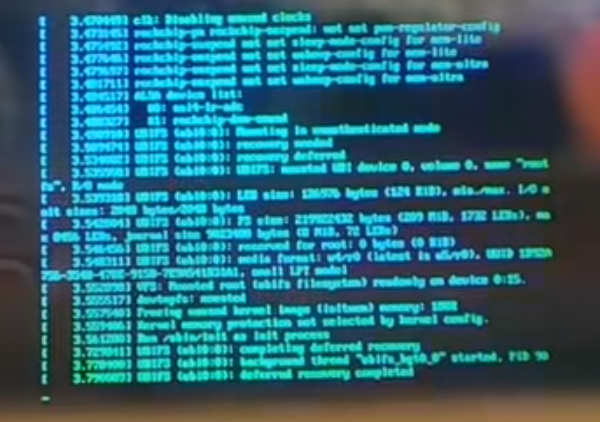
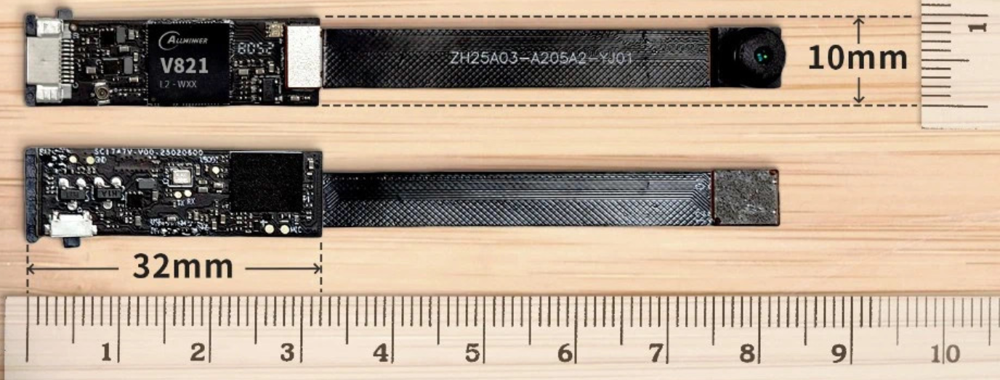
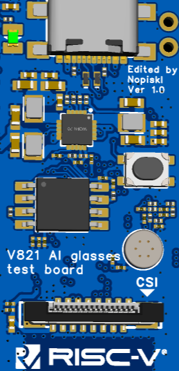

# V821 AI Glass

语言：[English](README.md) | 中文

本仓库主要包含两套 V821 AI 眼镜相关方案：

1. `v821-aiglass`
2. `v821-aiglass_fastboot`

## 项目说明

### v821-aiglass

`v821-aiglass` 是面向完整 AI Glass 形态的板级配置方案，使用光波导模组，可实现较完整的专业 AI 眼镜设计。

当前支持能力：

- 接入大模型 API 与图片识别能力
- 支持 `320 x 640` 图像显示与文字显示
- 支持一键拍摄、录像等功能

由于整机体积限制，该方案目前已完成 testboard 板级验证与模组可行性验证，整机组装仍在推进中。

<p>
  <a href="Application/Image/1.png"></a>
  <a href="Application/Image/debug.png"></a>
  <a href="Application/Image/2.png"></a>
</p>

### v821-aiglass_fastboot

`v821-aiglass_fastboot` 是基于 fastboot 的快速启动方案。由于 fastboot 与 SoC 耦合较深，可开发自由度相对受限，大部分配置来自原厂方案。

该方案参考了全志公板 `board` 与索智 V821 AI 眼镜开发板，并非传统 Linux 启动流程。通过 fastboot 可实现快速抓图、拍照与录像，整体控制在 1 秒以内。

当前支持能力：

- 接入大模型 API 与语音识别能力
- 支持呼叫 AI、拍照转发、智能分析
- 支持一键拍摄、录像等功能

<p>
  <a href="Application/Image/ai_glass.png"></a>
</p>

## 仓库目录

### Hardware_for_test

硬件测试相关内容，参考 AvaotaF1 设计版型。

当前提供了用于模组测试与功能验证的 testboard，适用于 `v821-aiglass`。后续会继续跟进更小尺寸的 PCB 设计，以便装入眼镜结构中。

<p>
  <a href="Application/Image/testboard.png"></a>
</p>

### Application

[`Application/aiglass-apps`](Application/aiglass-apps/README.md) 包含 C/C++ 应用源码、AGLink 支持库，以及 normal、拍照、录音、下载、OTA、录像和直播 7 个应用。

[`Application/lvgl-home`](Application/lvgl-home/) 提供 LVGL 8.x 的 `320 × 320`
眼镜主界面源码，显示日期、星期、时间和秒数，采用纯文字与图形线框，无背景图片。
该界面直接接入已有 LVGL 应用，不包含 LVGL 库，也不加入上述 7 个应用的独立构建。

`Application/Makefile` 提供统一构建入口，默认使用已启用这些应用的 `aiglass_fastboot` 板型。编译需要完整的 Tina V821 BSP、交叉工具链及已构建的依赖；本仓库的 `SDK/TinaLinux 5.0` 仅包含补丁。

```bash
make -C Application list
make -C Application check AIGLASS_BSP_ROOT=/absolute/path/to/tina-v821-release
make -C Application all AIGLASS_BSP_ROOT=/absolute/path/to/tina-v821-release
make -C Application package AIGLASS_BSP_ROOT=/absolute/path/to/tina-v821-release
```

依赖准备、rootfs 安装及 BSP 源码集成方法见[应用开发说明](Application/aiglass-apps/README.md)。编译和打包产物分别存放在 `Application/aiglass-apps/build`、`output`、`dist`，均已加入应用目录的 Git 忽略规则。

### SDK/TinaLinux 5.0

SDK 补丁与板级配置相关内容，主要包含：

- `v821-aiglass`
- `v821-aiglass_fastboot`

## 补丁使用方法

将补丁文件复制到 SDK 对应目录下，后续可参考全志在线文档继续进行板级开发：

https://docs.aw-ol.com/docs/soc/v821/
