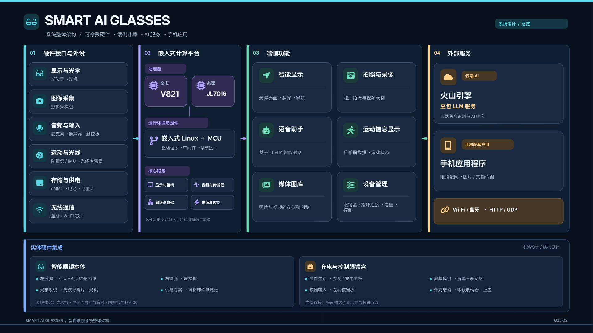
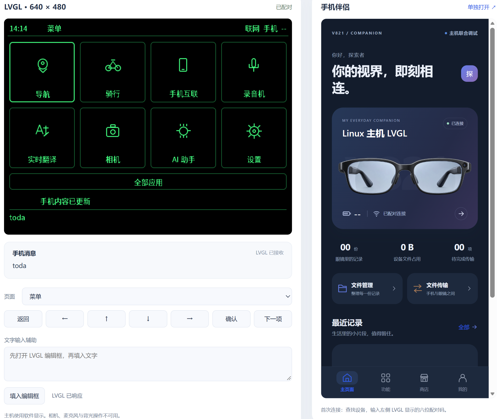
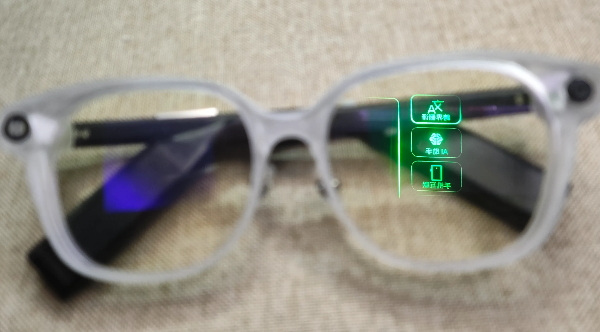
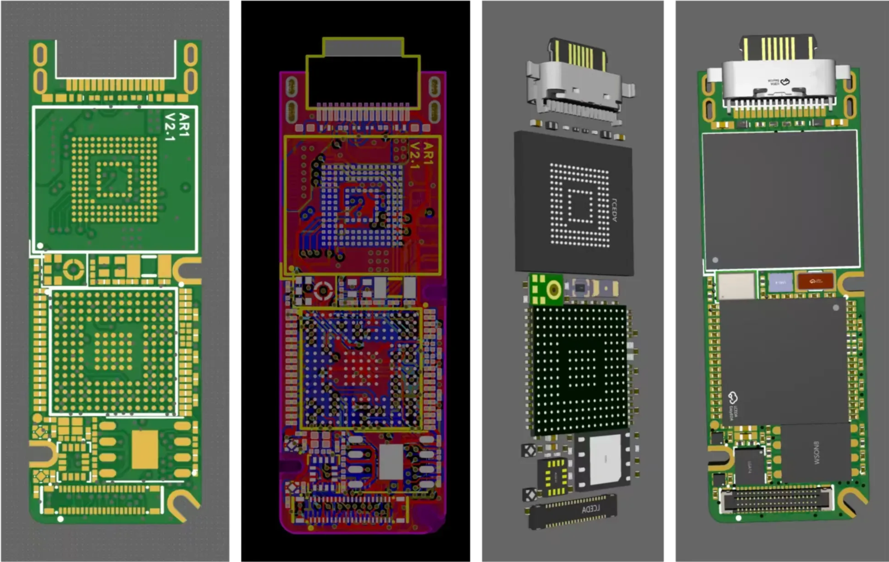
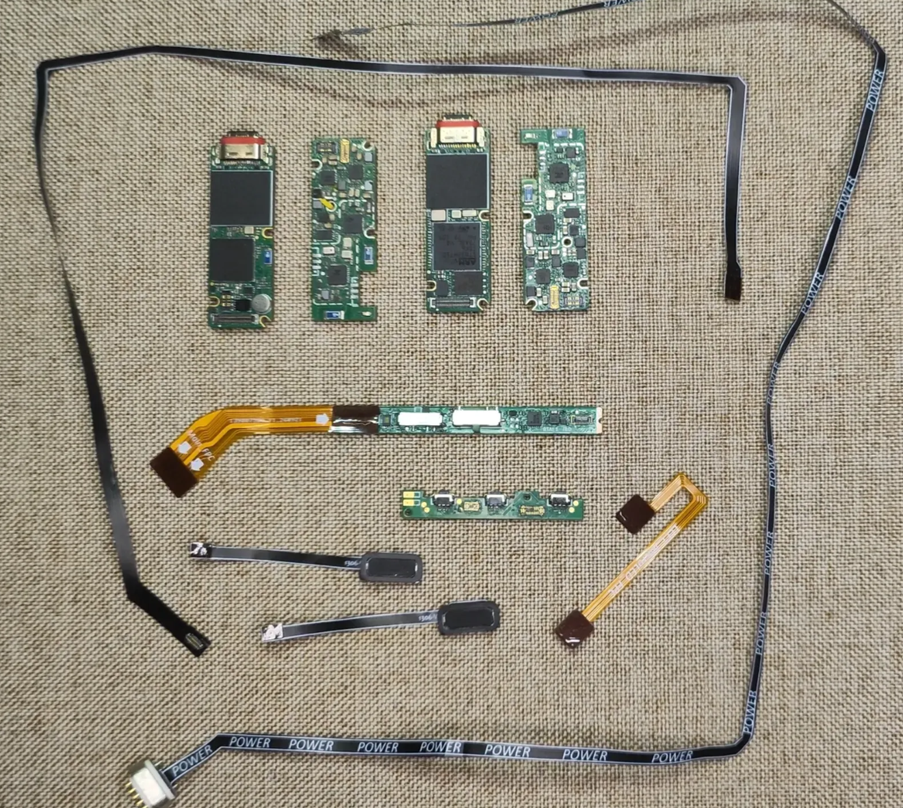
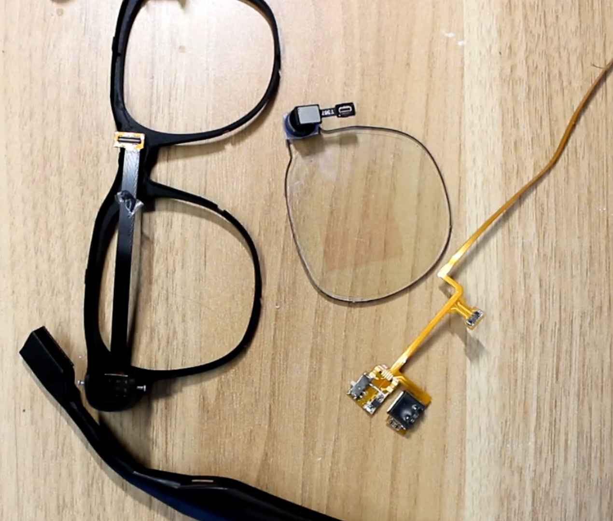
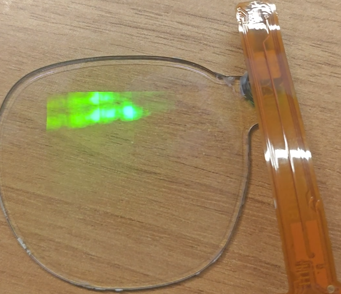
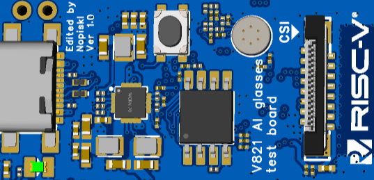

# V821 AI Glass

语言：[English](README.md) | 中文

本仓库提供 V821 AI 眼镜方案 `v821-aiglass` 的硬件设计、应用程序及 SDK 补丁。

## 项目说明

`v821-aiglass` 是采用光波导显示模组的 AI 眼镜板级配置方案。

整机方案的功能范围：

- 手机端协同的大语言模型（LLM）接入与图像识别。
- MicroOLED 显示，分辨率为 `640 × 480`，支持图像与文字输出。
- 一键拍照与录像、动态防抖及高分辨率成像。
- JL7016 负责待机蓝牙管理与音乐播放，使用 DSP 音频处理；常电 UI 模式由 V821 负责界面绘制与管理。
- 手机与眼镜之间的应用下载、文件上传及设备管理。
- 基于 LVGL 的眼镜界面和手机伴侣。

上述范围描述整机方案，各软件模块的实现与验证范围见对应文档。仓库内手机伴侣的构建目标为
uni-app H5；商店提供本地工具与模板目录，不提供眼镜应用安装。

硬件验证范围为测试板与模组。眼镜硬件设计文件见 [`Hardware/V821_ai_glasses`](Hardware/V821_ai_glasses/)。

## 系统架构

<p align="center">
  <a href="docs/images/SMART_AI_GLASSES_ZH.png"></a>
</p>

[矢量图（SVG）](docs/images/SMART_AI_GLASSES_ZH.svg) · [架构与开发文档](docs/README.md)

## 主机联调预览

Linux 主机通过 HTTP 桥接在浏览器中展示 `640 × 480` 原生 LVGL 界面与 uni-app H5 手机伴侣。
启动与操作方式见 [主机联调说明](Application/host-debug/README.md)。

<p align="center">
  <a href="docs/images/Simulate.png"></a>
</p>

## 仓库目录

### Hardware

#### V821_ai_glasses

[`Hardware/V821_ai_glasses`](Hardware/V821_ai_glasses/) 为光波导眼镜硬件项目，包含：

- [EDA 工程](Hardware/V821_ai_glasses/ProPrj_光波导AR眼镜_2026-10-26.epro2)：`.epro2` 格式的原理图与 PCB 设计文件。
- [原理图 PDF](Hardware/V821_ai_glasses/PDF_光波导AR眼镜.zip)：原理图文档压缩包。
- [图片资料](Hardware/V821_ai_glasses/Image/)：硬件实物照片及 PCB、FPC、3D 设计预览。

**硬件展示**

| 眼镜实物 | PCB 设计 | 硬件组件 |
| :---: | :---: | :---: |
| <a href="Hardware/V821_ai_glasses/Image/ai_glass.png"></a> | <a href="Hardware/V821_ai_glasses/Image/PCB_design.png"></a> | <a href="Hardware/V821_ai_glasses/Image/item_overview.png"></a> |

| 镜架与光波导模组 | 调试日志 | 光波导显示 |
| :---: | :---: | :---: |
| <a href="Hardware/AI_glass_avaota_suit/Image/1.png"></a> | <a href="Hardware/AI_glass_avaota_suit/Image/debug.png"></a> | <a href="Hardware/AI_glass_avaota_suit/Image/2.png"></a> |

#### AI_glass_avaota_suit

[`Hardware/AI_glass_avaota_suit`](Hardware/AI_glass_avaota_suit/) 为参考 AvaotaF1 设计的测试板，用于 `v821-aiglass` 模组测试与功能验证。目录包含 EDA 工程、原理图 PDF、Gerber 压缩包、STEP 模型及测试图片。

<p align="center">
  <a href="Hardware/AI_glass_avaota_suit/Image/testboard-horizontal.svg"></a>
</p>

### Application

[`Application/aiglass-apps`](Application/aiglass-apps/README.md) 用于 JL 主控、V821 不显示的受控模式，包含 AGLink 支持库及 normal、拍照、录音、下载、OTA、录像和直播 7 个应用。

[`Application/lvgl-home`](Application/lvgl-home/README.md) 提供 LVGL 8.3/8.4 绿色线框眼镜界面，
默认采用 `640 × 480` 横屏布局。包含 AI 对话、翻译、手机通信、录音、相机、
文件、笔记与设置等页面，使用 Linux 接口和可配置的 HTTP 服务。
常电显示模式的拍照、录像和录音通过 [`Application/mpp-media`](Application/mpp-media/README.md)
直接调用 V821 MPP；音频设备与通道可配置，不依赖 AGLink。两种模式的资源所有权、启动入口和
协议边界见[运行模式说明](docs/architecture/runtime-modes.md)。
该模块接入已有 LVGL 应用，LVGL 库由宿主提供，构建入口独立于上述 7 个受控应用。
开发验证使用 Linux 主机原生构建与集成测试；V821 目标端运行未验证。

[`Application/mobile-app`](Application/mobile-app/README.md) 是基于 uni-app / Vue 3 的独立手机伴侣，
以 H5 运行，包含首次配对、主页面、功能、商店和我的页面。
手机输入 LVGL 屏幕上的六位配对码后，可进行实际文件传输、文件管理、笔记和消息同步。
手机端通过 HTTP 桥接连接 LVGL 服务，服务不可用时显示离线。

[`Application/host-debug`](Application/host-debug/README.md) 提供 Linux 主机联合调试。运行画面与手机页面
通过同一端口预览，构建、依赖、日志及测试数据保存在工作区。主机模式不接入相机、麦克风、背光、
真实配网或 JL；AI 服务需另行配置。源码复用、进程与线程、接口、配对、存储及测试边界见
[模拟器架构说明](docs/architecture/host-simulator.md)。

`Application/Makefile` 提供 V821 应用的统一构建入口。编译需要完整的 Tina V821 BSP、交叉工具链及已构建的依赖；本仓库的 `SDK/TinaLinux 5.0` 仅包含补丁。手机端项目使用独立的 npm 命令。

```bash
make -C Application list
make -C Application check AIGLASS_BSP_ROOT=/absolute/path/to/tina-v821-release
make -C Application all AIGLASS_BSP_ROOT=/absolute/path/to/tina-v821-release
make -C Application package AIGLASS_BSP_ROOT=/absolute/path/to/tina-v821-release
```

依赖准备、rootfs 安装及 BSP 源码集成方法见[应用开发说明](Application/aiglass-apps/README.md)。编译和打包产物分别存放在 `Application/aiglass-apps/build`、`output`、`dist`，均已加入应用目录的 Git 忽略规则。

### SDK/TinaLinux 5.0

包含 `v821-aiglass` 的 SDK 补丁与板级配置。

### docs

[项目文档](docs/README.md) 集中维护系统架构、运行模式和展示资源，并提供模块开发说明及协议文档的索引。

## 补丁使用方法

将补丁文件复制到 SDK 对应目录，板级开发参考[全志 V821 在线文档](https://developers.allwinnertech.com/docs)。

## 致谢

`Hardware/V821_ai_glasses` 的硬件设计借鉴了 [sgsax 在立创开源硬件平台发布的 PCB 项目](https://oshwhub.com/sgsax/project_tiqnqiyt)。感谢原作者公开设计资料。
